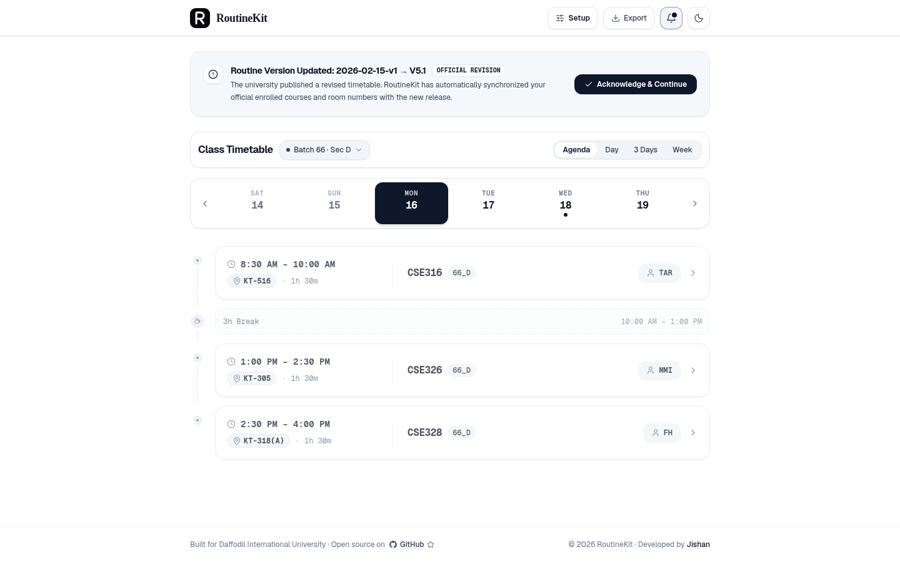
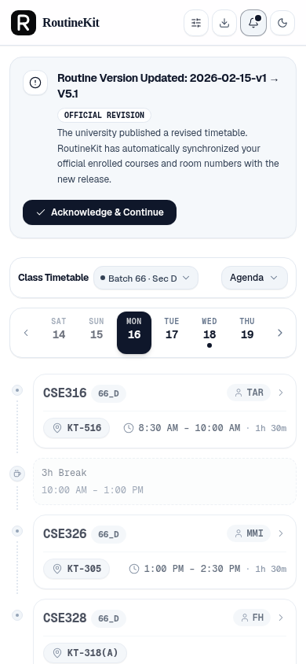
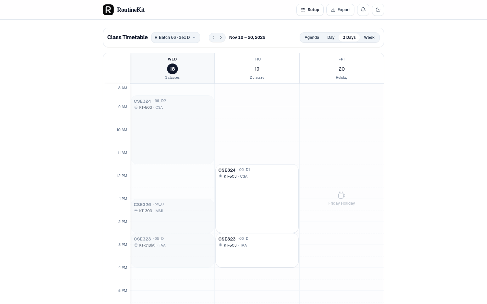
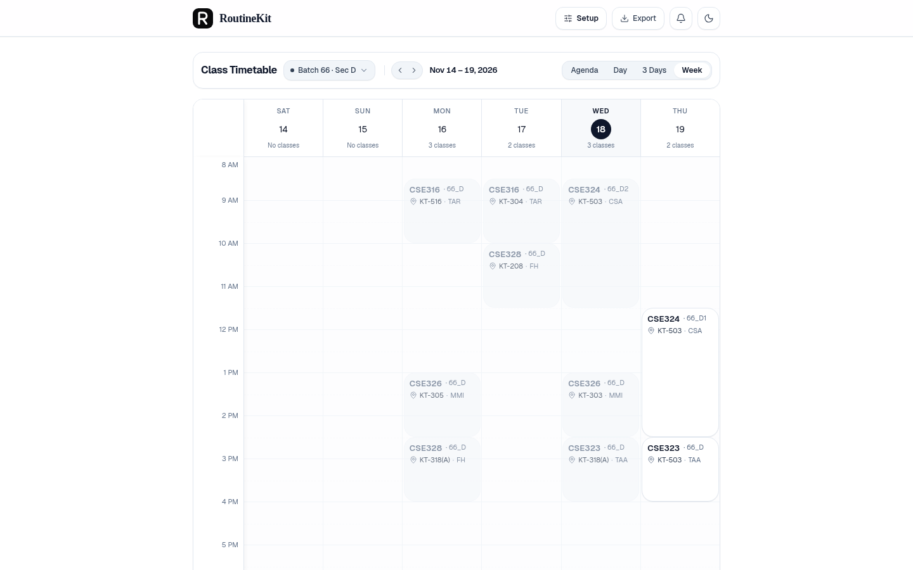

<div align="center">

# RoutineKit · DIU CSE

**High-craft, student-first class routine planner & timetable for Daffodil International University (DIU) CSE Department.**

[](https://nextjs.org/)
[](https://react.dev/)
[](https://www.typescriptlang.org/)
[](https://tailwindcss.com/)
[](https://nextjs.org/docs/app/building-your-application/deploying/static-exports)
[](LICENSE)

<br />

<p align="center">
  
</p>

</div>

---

## ⚡ Highlights

RoutineKit turns complex, multi-page university routine PDFs into a clean, instantaneous personal schedule tailored to every student's specific cohort, section, and retakes.

<table>
  <tr>
    <td width="50%" valign="top">
      <h3>📱 Mobile-First Native Experience</h3>
      <p>Clean, uncluttered, responsive layout designed for iOS & Android screens with instant 0ms cached loads, fluid date bar navigation, and collapsible cohort metrics.</p>
      
    </td>
    <td width="50%" valign="top">
      <h3>🗓️ 3-Day & Full Week Grids</h3>
      <p>Proportional time slots, automatic break indicators, holiday tags, and horizontal scrolling affordance optimized for busy university days.</p>
      
    </td>
  </tr>
</table>

<p align="center">
  
</p>

---

## ✨ Features

- **🎯 1-Click Cohort Enrollment** — Select your Batch and Section (e.g. `Batch 66 · Section D`) to populate your full academic week with zero manual entry.
- **⚡ Search & Add Modular Courses** — Add retake sections (`RE_A(3C)`), evening sections, or custom courses across different batches with instant search.
- **🛡️ Conflict & Overlap Detection** — Automatic interval detection warns students if two selected courses or lab sessions overlap in the timetable.
- **☕ Clean Break Indicators** — Gaps between classes are gracefully calculated and rendered with subtle duration indicators (no clutter).
- **🖨️ Multi-Format Production Exports**:
  - **Vector PDF Timetable** (`jsPDF`): Clean, printable official DIU routine grid formatted to A4 landscape.
  - **Google Calendar Sync** (`.ics`): RFC 5545 compliant calendar export with recurrence rules and accurate Dhaka timezones.
  - **Shareable Timetable Image**: High-resolution rendered timetable card for easy sharing.
- **🔒 100% Private & Local-First** — Zero user accounts, zero tracking, and zero servers. Preferences and customizations live in your browser (`localStorage` + Cache API).
- **🎨 Strict Monochrome Aesthetic** — Apple-inspired neutral slate & zinc design language, high contrast, full dark mode support, and zero visual noise.

---

## 🛠️ Tech Stack

- **Framework**: [Next.js 16](https://nextjs.org/) (App Router, Turbopack, `output: "export"`)
- **UI & Animation**: [React 19](https://react.dev/), [Tailwind CSS v4](https://tailwindcss.com/), [Motion](https://motion.dev/), [Radix UI](https://www.radix-ui.com/)
- **Document & Calendar Engine**: [jsPDF](https://github.com/parallax/jsPDF), custom ICS generator
- **Routine Data Pipeline**: Python 3.11+, [pdfplumber](https://github.com/jsvine/pdfplumber), [Pydantic](https://docs.pydantic.dev/)

---

## 🚀 Getting Started

### Prerequisites

- **Node.js**: v18.18+ (Node.js 20+ recommended)
- **Python**: v3.10+ (for running the routine scraper pipeline)
- **Make**: (optional, standard on Linux/macOS)

### 1. Installation

```bash
# Clone the repository
git clone https://github.com/jishanws/routinekit-diu.git
cd routinekit-diu

# Install Node dependencies
npm install

# Setup Python scraper virtual environment (optional)
make setup
```

### 2. Run Local Development Server

```bash
npm run dev
```

Visit [http://localhost:3000](http://localhost:3000) in your browser.

### 3. Verify & Test

```bash
# Run schedule logic, retake rules, and PDF/ICS export test suite
npm test

# Run ESLint
npm run lint

# Build static production export
npm run build
```

---

## 🔄 Routine Scraper Pipeline

RoutineKit uses a standalone Python pipeline to extract and validate class data directly from official DIU CSE routine PDFs:

```bash
# Parse a local routine PDF and update public/data/routine-latest.json
make scrape-local LOCAL_PDF=path/to/official_routine.pdf

# Run full automated scraper pipeline
make scrape
```

The pipeline:
1. Extracts raw tabular cells via `pdfplumber`.
2. Validates day names, 12h/24h time bounds, rooms, teacher initials, and batch codes with Pydantic schemas.
3. Performs atomic publishing — ensures a corrupt or incomplete PDF never overwrites the last-known-good routine.

---

## 📂 Project Structure

```text
routinekit-diu/
├── public/
│   ├── data/
│   │   ├── routine-latest.json    # Canonical published routine data
│   │   └── routine-status.json    # Version tag, semester, update date
├── scraper/                       # Python routine PDF extraction pipeline
│   ├── parser.py                  # Table & cell extraction logic
│   ├── validator.py               # Integrity & schema enforcement
│   └── publish.py                 # Atomic data publisher
├── src/
│   ├── app/                       # Next.js App Router (Static export)
│   ├── components/
│   │   ├── timetable/             # Agenda, 3-Day Grid, Week Grid, Hero
│   │   ├── modal/                 # Setup, Export, Course Details dialogs
│   │   └── ui/                    # Accessible monochrome primitives
│   ├── lib/
│   │   ├── routine/               # Schedule resolution, conflict engine, filters
│   │   ├── export/                # jsPDF table engine & RFC 5545 ICS builder
│   │   └── storage/               # LocalStorage schema & migration
│   └── types/                     # TypeScript schedule contracts
└── scripts/                       # Schedule & export unit test suites
```

---

## 📄 License

Distributed under the MIT License. Built for Daffodil International University students.
